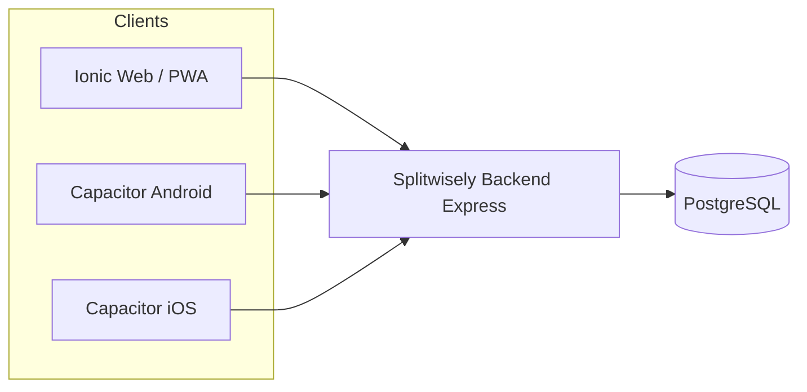
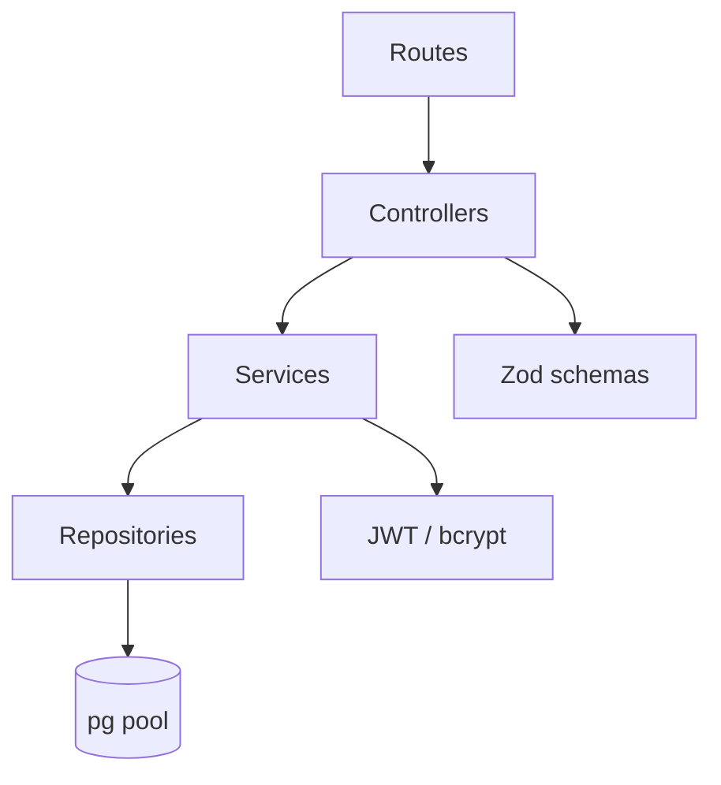
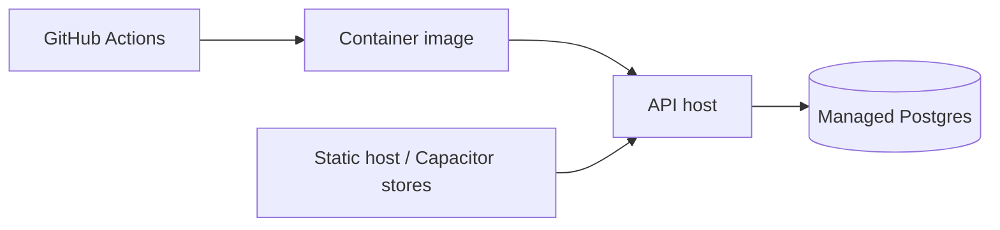
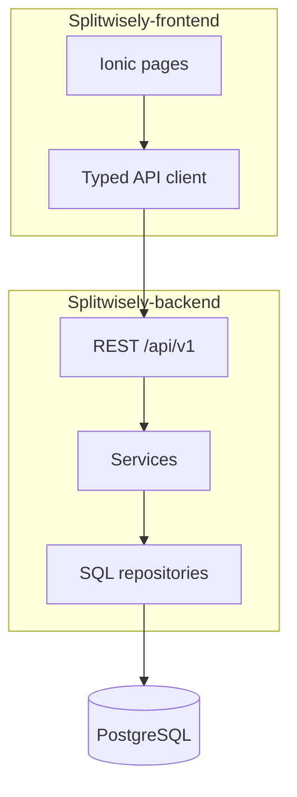

# Splitwisely — Architecture

## System context



Two GitHub repos. Frontend never talks to Postgres. Contract: `docs/api.md` → OpenAPI.

## Backend layers



| Layer | Responsibility |
| --- | --- |
| Routes | Path mounting, middleware (auth, rate limit) |
| Controllers | Parse req, call service, map HTTP status |
| Services | Domain rules, transactions, debt simplify, rounding |
| Repositories | Parameterized SQL only |

Suggested folders (Phase 1):

```
src/
  app.ts
  server.ts
  config/
  middleware/
  modules/
    auth/
    users/
    groups/
    expenses/
    settlements/
    activity/
  db/
    pool.ts
    migrate.ts
  utils/
migrations/
```

## Frontend structure (sibling repo)

Ionic Angular standalone components + signals. Feature folders: `auth`, `dashboard`, `groups`, `expenses`, `friends`, `activity`, `profile`. Shared UI: glass card, amount pipe (minor → display). HTTP interceptor attaches access token; refresh queue on 401.

## Auth design

| Token | Lifetime (proposed) | Storage |
| --- | --- | --- |
| Access JWT | 15 minutes | Memory (web); secure storage (native) |
| Refresh | 14–30 days | HttpOnly cookie optional later; v1 body + Capacitor Secure Storage |

- Refresh **rotation**: each use issues new refresh; old hashed row revoked.
- Reuse of revoked token in family → revoke entire `family_id`.
- Password: argon2id preferred (bcrypt acceptable).

## Cross-repo env

| Var | Repo | Purpose |
| --- | --- | --- |
| `DATABASE_URL` | backend | Postgres connection |
| `JWT_ACCESS_SECRET` | backend | Sign access tokens |
| `JWT_REFRESH_SECRET` | backend | Sign/hash refresh material |
| `FRONTEND_ORIGIN` | backend | CORS allowlist (e.g. `http://localhost:4200`) |
| `PORT` | backend | Default 3000 |
| `API_BASE_URL` | frontend | e.g. `http://localhost:3000/api/v1` |

## Errors & logging

- Map domain errors → HTTP via typed `AppError` (`code`, `status`).
- Structured JSON logs: `level`, `msg`, `requestId`, `userId?`. No passwords/tokens in logs.
- Request ID middleware; propagate in error responses optionally.

## Environments

| Env | API | DB |
| --- | --- | --- |
| local | `localhost:3000` | Docker Compose `splitwisely` DB |
| test | ephemeral | Docker service in CI |
| prod | managed host | managed Postgres |

## Deployment sketch



Phase 7: deploy API + managed Postgres; host web SPA; Android via Play (optional).

## Component diagram


