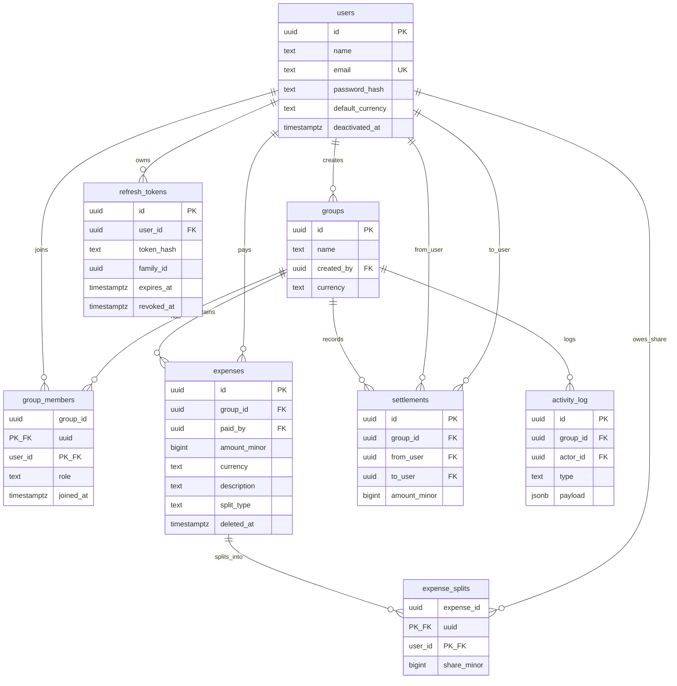

# Splitwisely — Database

PostgreSQL. No ORM. Amounts in **minor units** (`BIGINT`). Default currency **INR** (paise). Soft-delete expenses via `deleted_at`.

## ER overview



## DDL (target schema)

```sql
CREATE EXTENSION IF NOT EXISTS "pgcrypto";

CREATE TABLE users (
  id                UUID PRIMARY KEY DEFAULT gen_random_uuid(),
  name              TEXT NOT NULL,
  email             TEXT NOT NULL UNIQUE,
  password_hash     TEXT NOT NULL,
  default_currency  TEXT NOT NULL DEFAULT 'INR',
  created_at        TIMESTAMPTZ NOT NULL DEFAULT now(),
  updated_at        TIMESTAMPTZ NOT NULL DEFAULT now(),
  deactivated_at    TIMESTAMPTZ
);

CREATE TABLE groups (
  id          UUID PRIMARY KEY DEFAULT gen_random_uuid(),
  name        TEXT NOT NULL,
  created_by  UUID NOT NULL REFERENCES users(id),
  currency    TEXT NOT NULL DEFAULT 'INR',
  created_at  TIMESTAMPTZ NOT NULL DEFAULT now(),
  updated_at  TIMESTAMPTZ NOT NULL DEFAULT now()
);

CREATE TABLE group_members (
  group_id   UUID NOT NULL REFERENCES groups(id),
  user_id    UUID NOT NULL REFERENCES users(id),
  role       TEXT NOT NULL CHECK (role IN ('admin', 'member')),
  joined_at  TIMESTAMPTZ NOT NULL DEFAULT now(),
  PRIMARY KEY (group_id, user_id)
);

CREATE TABLE expenses (
  id            UUID PRIMARY KEY DEFAULT gen_random_uuid(),
  group_id      UUID NOT NULL REFERENCES groups(id),
  paid_by       UUID NOT NULL REFERENCES users(id),
  amount_minor  BIGINT NOT NULL CHECK (amount_minor > 0),
  currency      TEXT NOT NULL,
  description   TEXT NOT NULL DEFAULT '',
  split_type    TEXT NOT NULL CHECK (split_type IN ('equal', 'exact', 'percentage', 'shares')),
  created_at    TIMESTAMPTZ NOT NULL DEFAULT now(),
  updated_at    TIMESTAMPTZ NOT NULL DEFAULT now(),
  deleted_at    TIMESTAMPTZ
);

CREATE TABLE expense_splits (
  expense_id   UUID NOT NULL REFERENCES expenses(id),
  user_id      UUID NOT NULL REFERENCES users(id),
  share_minor  BIGINT NOT NULL CHECK (share_minor >= 0),
  PRIMARY KEY (expense_id, user_id)
);

CREATE TABLE settlements (
  id            UUID PRIMARY KEY DEFAULT gen_random_uuid(),
  group_id      UUID NOT NULL REFERENCES groups(id),
  from_user     UUID NOT NULL REFERENCES users(id),
  to_user       UUID NOT NULL REFERENCES users(id),
  amount_minor  BIGINT NOT NULL CHECK (amount_minor > 0),
  note          TEXT NOT NULL DEFAULT '',
  created_at    TIMESTAMPTZ NOT NULL DEFAULT now(),
  CHECK (from_user <> to_user)
);

CREATE TABLE activity_log (
  id          UUID PRIMARY KEY DEFAULT gen_random_uuid(),
  group_id    UUID NOT NULL REFERENCES groups(id),
  actor_id    UUID NOT NULL REFERENCES users(id),
  type        TEXT NOT NULL,
  payload     JSONB NOT NULL DEFAULT '{}',
  created_at  TIMESTAMPTZ NOT NULL DEFAULT now()
);

CREATE TABLE refresh_tokens (
  id          UUID PRIMARY KEY DEFAULT gen_random_uuid(),
  user_id     UUID NOT NULL REFERENCES users(id),
  token_hash  TEXT NOT NULL UNIQUE,
  family_id   UUID NOT NULL,
  expires_at  TIMESTAMPTZ NOT NULL,
  revoked_at  TIMESTAMPTZ,
  created_at  TIMESTAMPTZ NOT NULL DEFAULT now()
);
```

### App-enforced invariants (not only DB)

- Sum of `expense_splits.share_minor` for an expense **equals** `expenses.amount_minor`.
- Expense `currency` matches parent `groups.currency` in v1.
- `paid_by` and every split `user_id` must be members of `group_id`.

## Indexes

| Index | Reason |
| --- | --- |
| `expenses (group_id, created_at DESC)` | Group detail expense list |
| `expense_splits (user_id)` | User-centric balance joins |
| `settlements (group_id, created_at DESC)` | Group settlements |
| `activity_log (group_id, created_at DESC)` | Activity feed |
| `activity_log (actor_id, created_at DESC)` | Optional user feed |
| `group_members (user_id)` | "My groups" lookup |
| `refresh_tokens (user_id)` | Logout / rotation |
| `refresh_tokens (family_id)` | Reuse detection |

```sql
CREATE INDEX idx_expenses_group_created ON expenses (group_id, created_at DESC);
CREATE INDEX idx_expense_splits_user ON expense_splits (user_id);
CREATE INDEX idx_settlements_group_created ON settlements (group_id, created_at DESC);
CREATE INDEX idx_activity_group_created ON activity_log (group_id, created_at DESC);
CREATE INDEX idx_group_members_user ON group_members (user_id);
CREATE INDEX idx_refresh_tokens_user ON refresh_tokens (user_id);
CREATE INDEX idx_refresh_tokens_family ON refresh_tokens (family_id);
```

Record `EXPLAIN ANALYZE` before/after in Phase 4 docs notes.

## Rounding rule (uneven splits)

When dividing `amount_minor` into N equal shares:

1. `base = floor(amount_minor / N)`
2. `remainder = amount_minor - base * N`
3. Assign `base` to everyone; assign **+1** to the first `remainder` participants in **stable sort by `user_id` ascending**, except: if the payer is among participants, give remainder paisa to the **payer first**, then fill remaining remainder slots by `user_id` ascending among others.

For percentages/shares: compute floor shares, distribute leftover paisa with the same remainder rule. **Always assert sum(shares) === amount_minor** before commit.

## Debt simplification

1. Compute net balance per member (positive = owed money, negative = owes).
2. Split into creditors (desc) and debtors (asc by net, i.e. most negative first).
3. Greedy: match largest creditor with largest debtor; create a suggested payment of `min(|debt|, credit)`; reduce both; repeat until all zero.
4. Implemented in service layer; unit-tested. Does not mutate DB until user records a settlement.

## Query catalog

### Net balance per member (one group)

```sql
WITH expense_impact AS (
  SELECT e.paid_by AS user_id, SUM(e.amount_minor) AS paid
  FROM expenses e
  WHERE e.group_id = $1 AND e.deleted_at IS NULL
  GROUP BY e.paid_by
),
split_impact AS (
  SELECT s.user_id, SUM(s.share_minor) AS owed
  FROM expense_splits s
  JOIN expenses e ON e.id = s.expense_id
  WHERE e.group_id = $1 AND e.deleted_at IS NULL
  GROUP BY s.user_id
),
settlement_impact AS (
  SELECT from_user AS user_id, SUM(amount_minor) AS delta
  FROM settlements WHERE group_id = $1
  GROUP BY from_user
  UNION ALL
  SELECT to_user AS user_id, -SUM(amount_minor) AS delta
  FROM settlements WHERE group_id = $1
  GROUP BY to_user
),
settlement_net AS (
  SELECT user_id, SUM(delta) AS settled
  FROM settlement_impact
  GROUP BY user_id
)
SELECT
  gm.user_id,
  COALESCE(ei.paid, 0) - COALESCE(si.owed, 0) + COALESCE(sn.settled, 0) AS net_minor
FROM group_members gm
LEFT JOIN expense_impact ei ON ei.user_id = gm.user_id
LEFT JOIN split_impact si ON si.user_id = gm.user_id
LEFT JOIN settlement_net sn ON sn.user_id = gm.user_id
WHERE gm.group_id = $1;
```

**Plain English:** Paid amounts increase your balance; your shares decrease it. Settlements you **send** increase your net (you owe less); settlements you **receive** decrease your net (others owe you less). Soft-deleted expenses are ignored. Positive net = you are owed.


### Pairwise balances (optional detail)

Derive from net balances via simplification, or compute directed edges from each expense (payer owed `share` by each splittee) minus settlements. Prefer net + simplify for the UI "who pays whom" list.

### Group totals

```sql
SELECT
  COALESCE(SUM(amount_minor), 0) AS total_spent_minor,
  COUNT(*) AS expense_count
FROM expenses
WHERE group_id = $1 AND deleted_at IS NULL;
```

### Dashboard: you owe / you are owed (across groups)

Sum negative nets into "you owe" and positive nets into "you are owed" across all groups the user belongs to (run net-balance per group, aggregate in service, or a single SQL wrapping the CTE filtered by `user_id = $1`).

### Activity feed

```sql
SELECT a.*
FROM activity_log a
JOIN group_members gm ON gm.group_id = a.group_id AND gm.user_id = $1
ORDER BY a.created_at DESC
LIMIT $2 OFFSET $3;
```

## Migrations

Use `node-pg-migrate` with plain SQL files. First migration creates the DDL above. Never edit applied migrations; add new ones.
