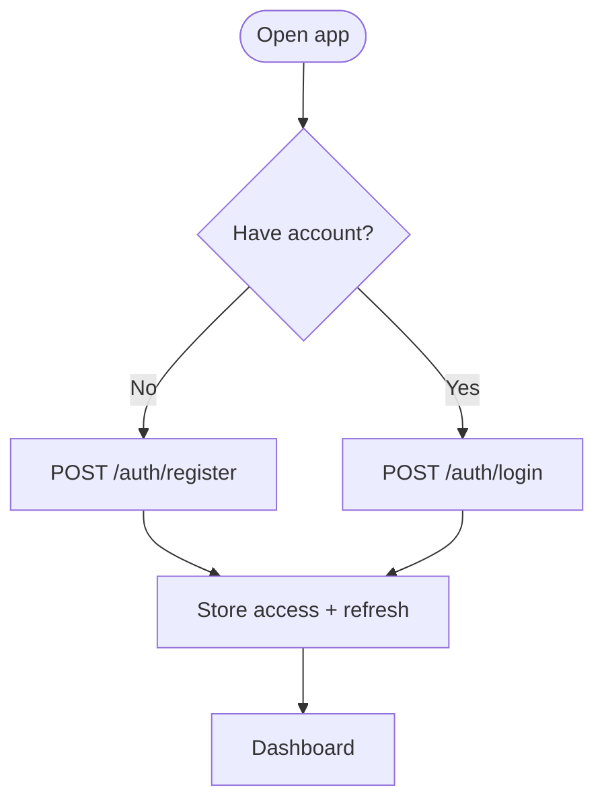
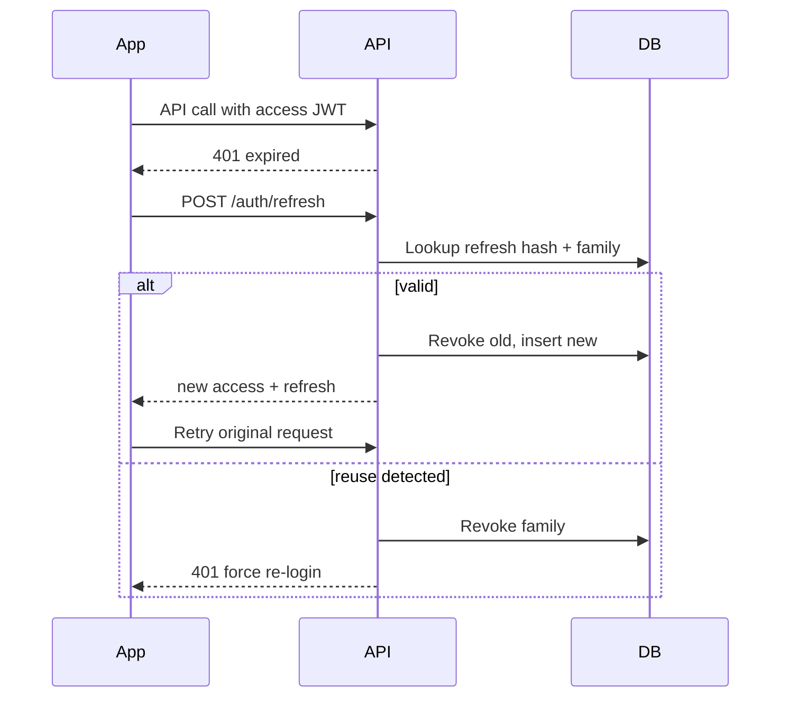
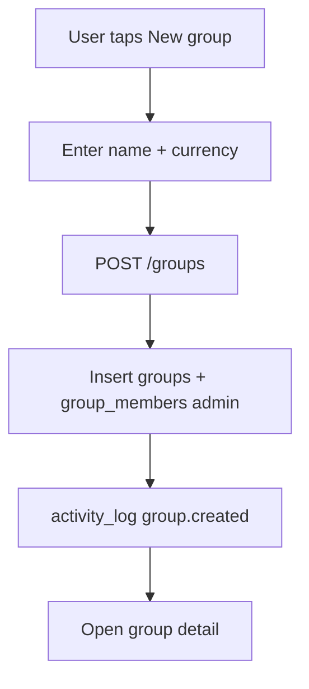
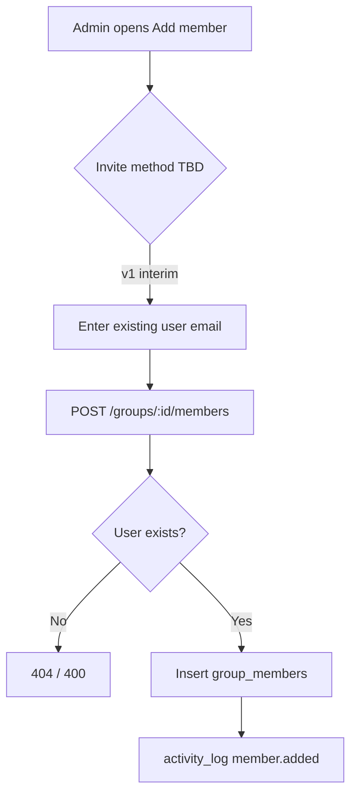
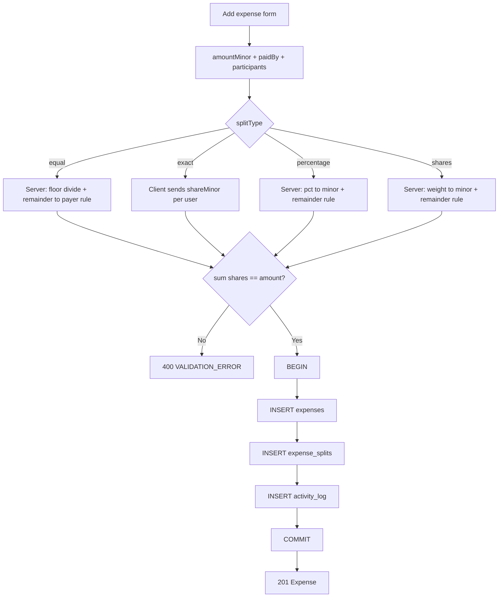
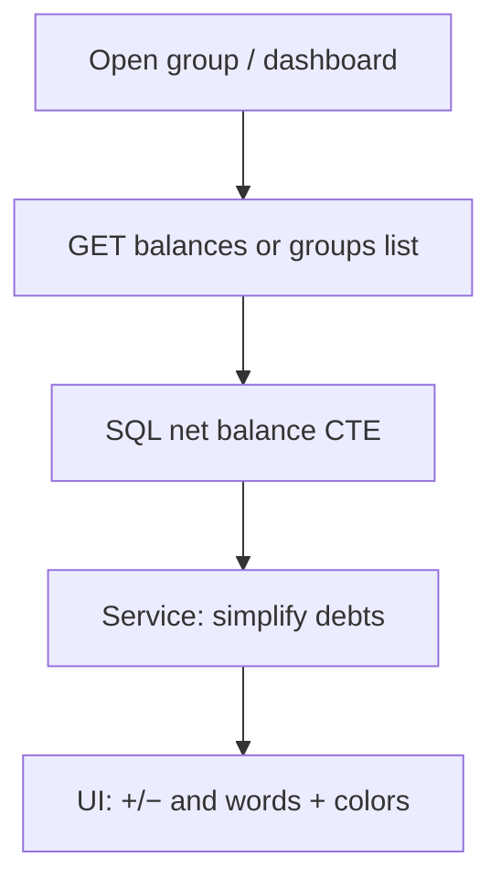
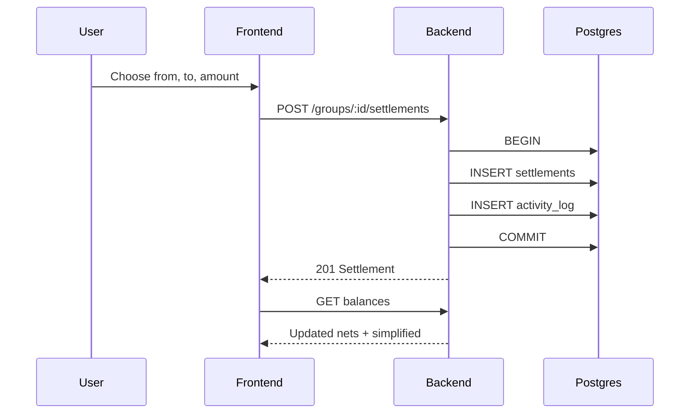
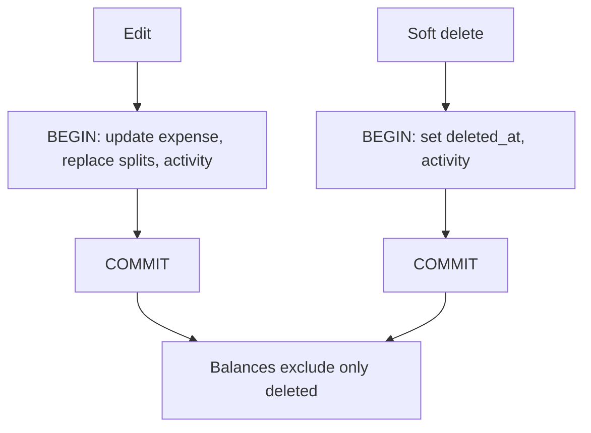

# Splitwisely — Flows

## Sign up / login

## Token refresh

## Create group

## Invite / add member

## Add expense (all split types)

## View balances

## Settle up

## Delete or edit expense

