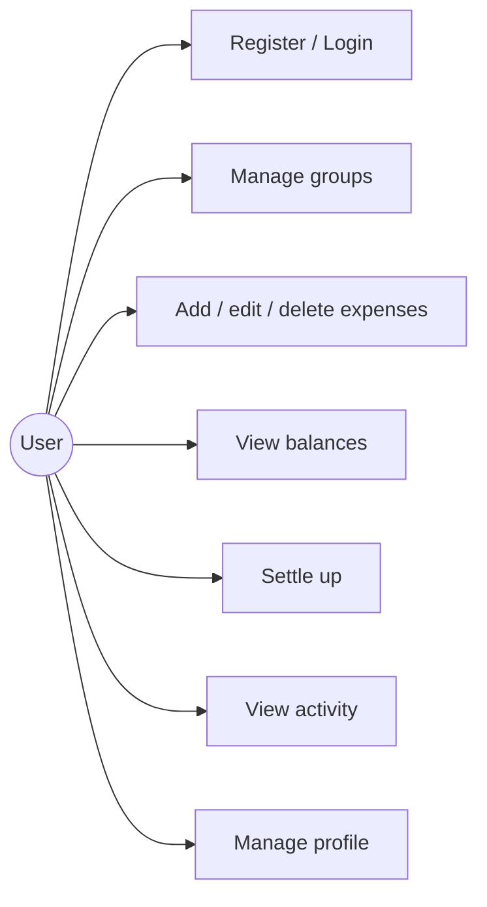
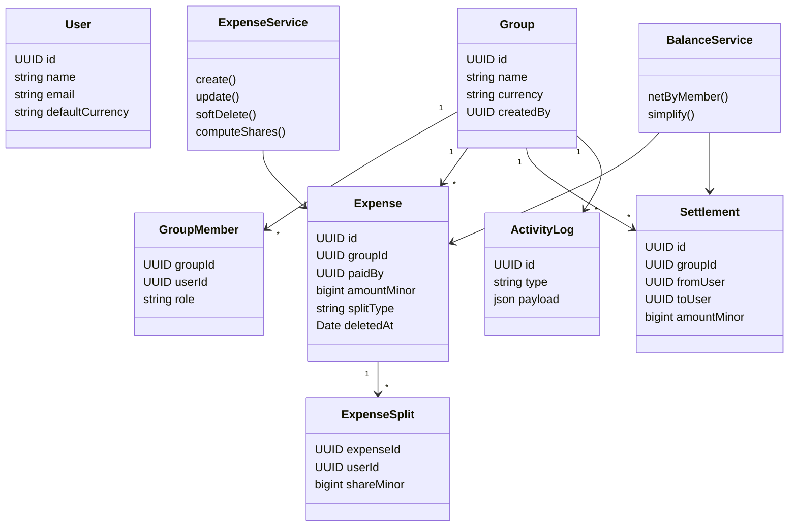
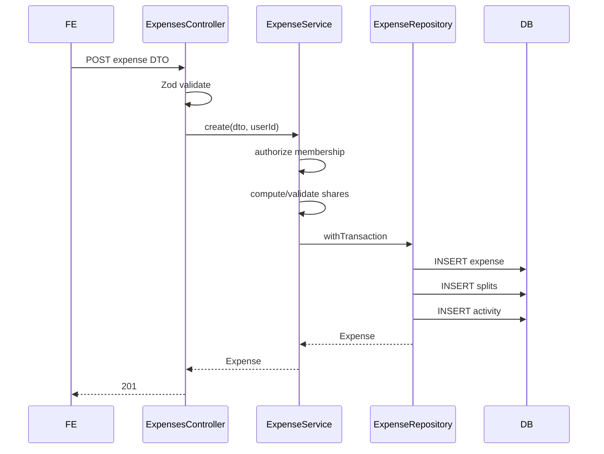
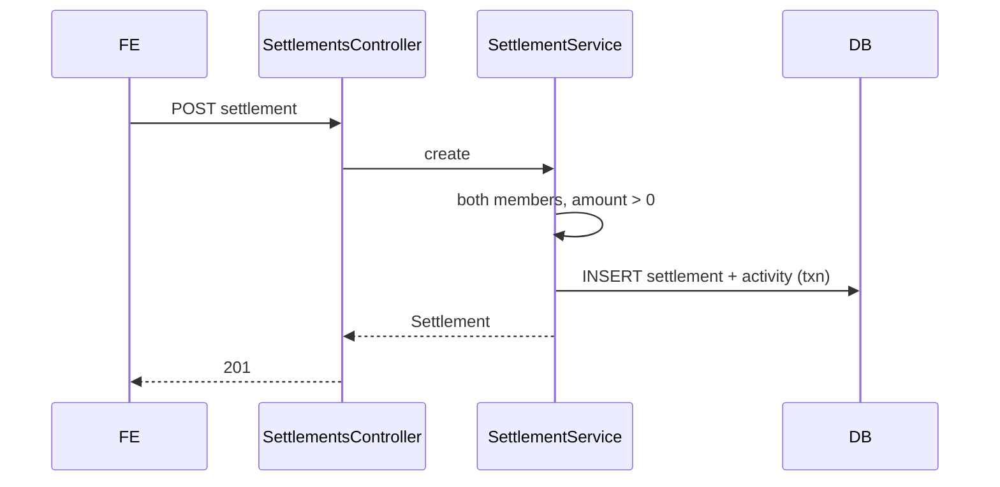
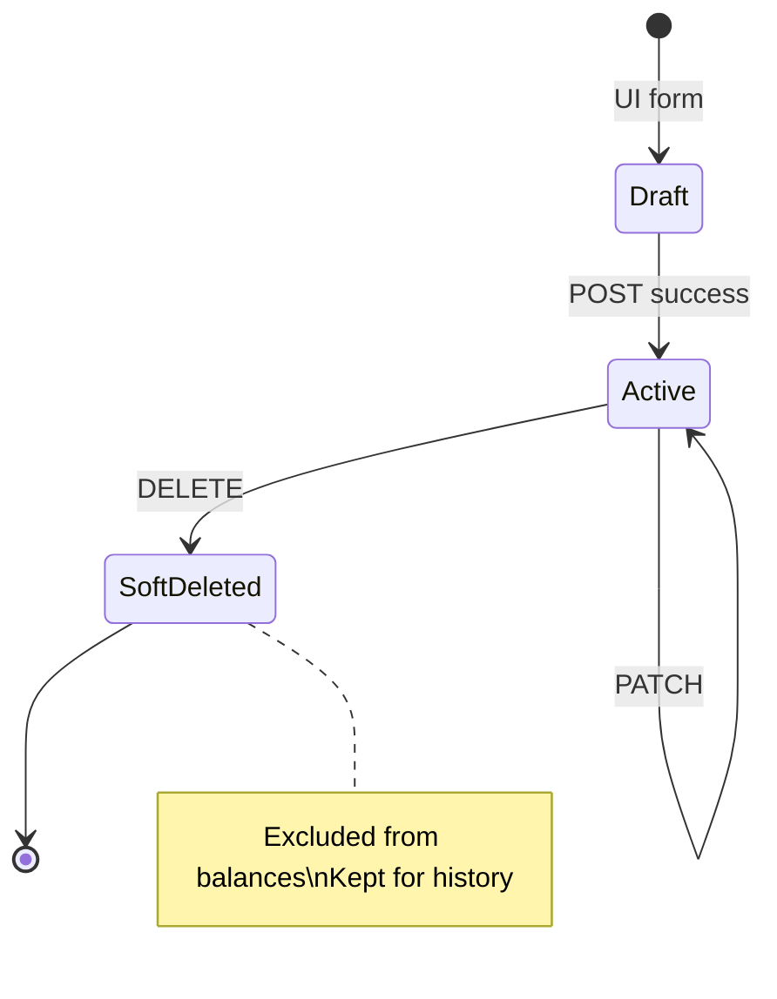

# Splitwisely — UML Diagrams

## Use-case overview

## Class diagram (domain + services)

## Sequence: add expense

## Sequence: settle up

## State: expense lifecycle

## ER diagram

See [`database.md`](./database.md) for the full Mermaid ER diagram and DDL.
